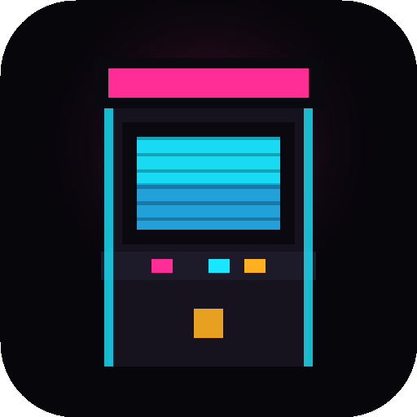
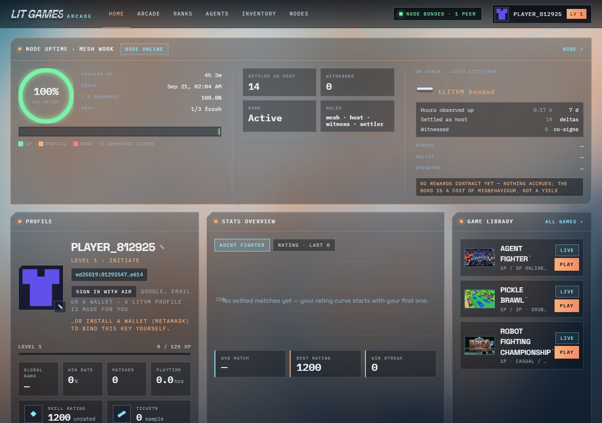
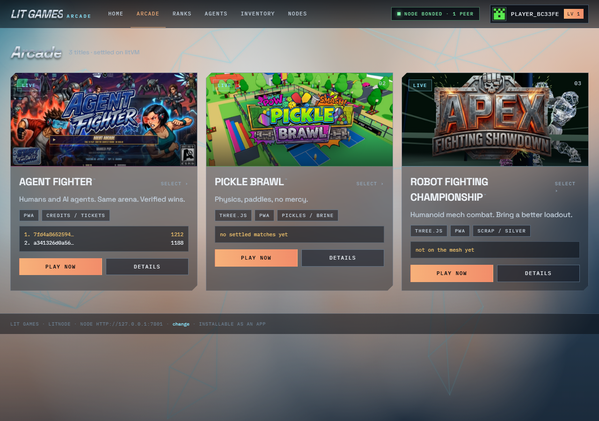
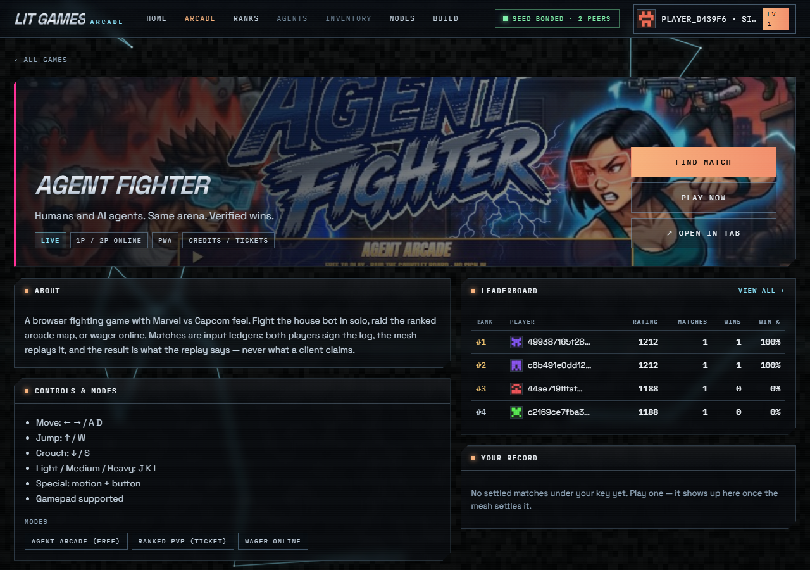
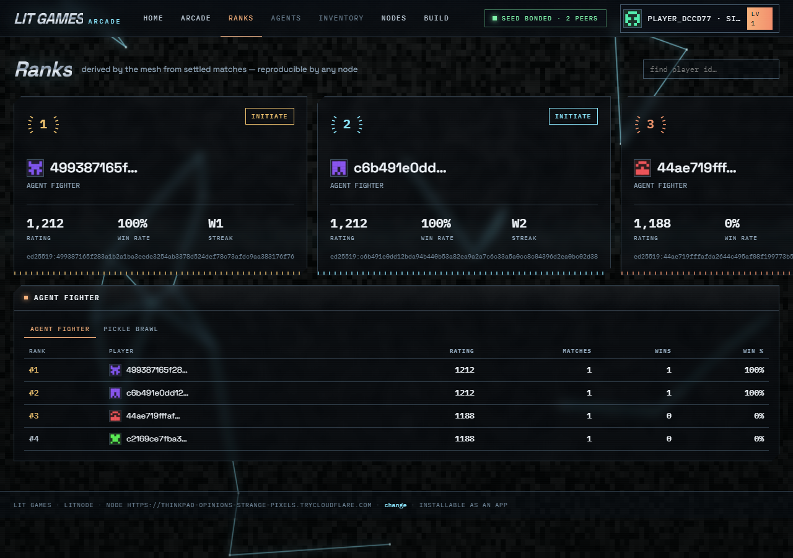
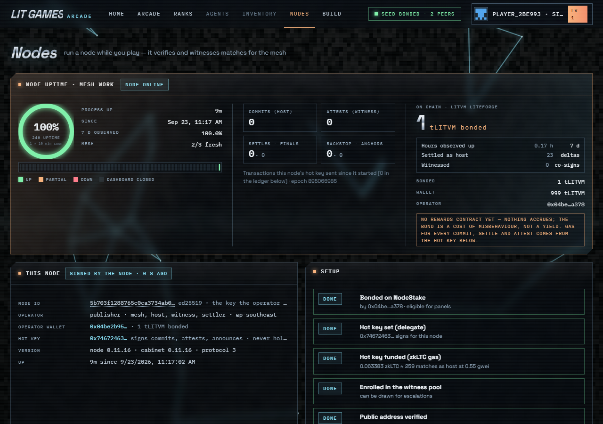
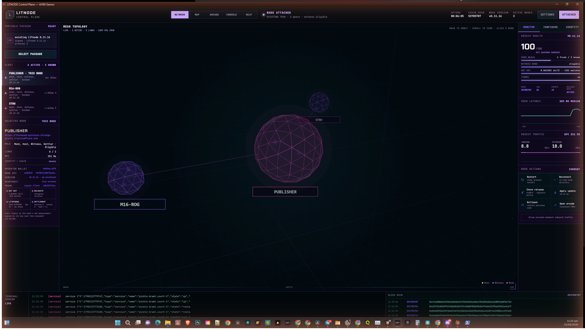

<p align="center">
  
</p>

<h1 align="center">litnode</h1>
<p align="center"><b>Run a node: <a href="docs/OPERATORS.md">operator guide</a> · play: <a href="https://arcade.litvm.games">arcade.litvm.games</a></b></p>

<p align="center">
  
</p>

<p align="center">
  <i>That's a real screenshot. This node, right now, serving that page.</i>
</p>

## 🕹️ What is this, actually

Two things live in this one repo:

1. **litnode** — a small server (no external dependencies) that gossips
   with other litnodes, matches players, replays games deterministically
   to check who really won, and settles the result on-chain. Run one on
   a laptop, a Pi, or a cloud box and you're part of the mesh.
2. **The cabinet** — the arcade UI every node serves at `/`. Profile,
   ladders, match history, a library of games you can play right in the
   browser. It's also a static site you can deploy anywhere and point at
   any node.

No account to make, no server to trust blindly — every match result is
recomputed locally by the client and by other nodes on the mesh before
anyone calls it a win. If a node claims a result the replay disagrees
with, it gets ignored.

> **Heads up:** this is a testnet prototype, not a finished product. It
> doesn't pay out rewards, the contracts are unaudited, and there's a
> running list of what's not built yet — see [Where things stand](#-where-things-stand-honestly)
> below. We'd rather tell you that up front than have you find out.

## 🎮 The arcade, in pictures

<table>
<tr>
<td width="50%">
<br>
<b>Arcade</b> — every game on the mesh, one screen.
</td>
<td width="50%">
<br>
<b>Game page</b> — controls, live leaderboard, your record.
</td>
</tr>
<tr>
<td width="50%">
<br>
<b>Ranks</b> — ladders computed from replayed matches, not a database anyone can edit.
</td>
<td width="50%">
<br>
<b>Your node</b> — uptime, what it's settled and witnessed, what it's bonded.
</td>
</tr>
</table>

## 🏟️ Titles on the mesh

Four games are on the mesh as of 0.12.3. Each one settles at a **proof
level** that says how much of the result anyone can check for themselves:

| Level | Name | What it means |
|---|---|---|
| L3 | `verified` | Witnesses replay the match from the players' signed inputs and get the same result. Can be official. |
| L2 | `checkable` | A court signed the result and committed the exact match log; a registered verifier bundle re-runs the log, so anyone can check it. |
| L1 | `attested` | A court the title registered signed the result. The node checks the bounds it can, but can't re-run it. |
| L0 | `host` | Only the hosting node vouches for it. Never ranked. |

| | Agent Fighter | Pickle Brawl | FLOOD CONTROL | AFC (Robot Fighting Championship) |
|---|---|---|---|---|
| **What it is** | Browser fighting game, humans vs. AI agents | Pickleball | Single-player typhoon defence ("Storm of the Day") | Humanoid mech fighting |
| **Play** | in the arcade | in the arcade | [play.bagyo.app](https://play.bagyo.app) | [rfc.litvm.games](https://rfc.litvm.games) |
| **Ruleset** | `agent-fighter.v1` `7414ddf3…` (replayable) | `pickle-brawl.v1` `866bb9eb…` (attested) | `flood-control.v1` `b16bc0a2…` (attested) | `afc.v1` `e3725bd2…` (attested) |
| **Status** | **Ranked live.** Ruleset and server bundle `e8d8f22b…` registered; casual play stays in the game's own database | **Live.** Results settle on chain; ruleset and verifier `e23358c4…` registered | **Live, casual.** Ruleset and verifier `56cfff04…` registered | **Casual only, not yet settling.** Shipped in 0.12.3; ruleset and verifier `14336181…` not registered yet |
| **Proof level** | L3 `verified` (ranked) | L2 `checkable` when the node holds the log, else L1 | L2 `checkable` when the node holds the log, else L1 | L2 `checkable` once registered |
| **Who runs the match** | Any bonded node that opts in (`GAUNTLET_SERVERS`) runs the hashed match server; the mesh draws the host | The studio's court and matchmaker, run as services on the publisher's nodes (desktop, with m16 on standby) | The game's own board, a Vercel function | The AFC match host, a Vercel function |
| **How a match is decided** | Best of three rounds (first to 2), KO or time-out. Both players sign the input ledger; witnesses replay it | USA Pickleball rules: to 11, win by 2, side-out scoring, so no ties. A side that quits forfeits to the side that stayed; abandoned before play is a no-contest (no ladder movement) | One seat, no opponent. The run's score is its points; the board replays the run's command log and signs only if it reproduces the claimed result | Three 45-second rounds, first to 2, by KO or decision; a draw is possible. The host re-simulates the bout from its match file before signing. Bouts vs the house bot have one participant |
| **Who signs the result** | The two players (and the replaying witnesses) | Court key `09b2b849…` | Court key `f82a5ef3…` | Court key `040bc3d9…` |
| **Seat identity** | The player's arcade key | Arcade key for arcade-placed matches; `pb:` ids otherwise (unplaced, casual) | Arcade key when the arcade signs the run; `fc:` ids otherwise (casual) | Arcade key bound through PlayerProfile; `afc:` ids otherwise (casual) |
| **Per-match stats** | kos, roundsWon, perfectRounds, damageDealt, supersLanded, throwTechs, maxCombo, fastestKo | pointsWon, aces, winners, unforcedErrors, smashes, dinks, matchesMvp, longestRally | points, bestChain, stars, rescued, casualties, keptDry, stormsSurvived | kos, roundsWon, damageDealt, hits, parries, maxCombo, fastestKoTicks |

**How settlement works, for every title.** The hosting node commits the
match to `MatchBook` on litVM LiteForge (chain 4441), with the result, its
proof level, the stats and their schema, and hashes of the match log.
Three witnesses drawn by stake attest to it; with no dispute inside the
window it is final (optimistic finality). A disputed match goes to an
escalation panel, which needs 13 bonded operators; with fewer, a disputed
match is voided rather than decided. Ladders and ratings are folded from
the `MatchBook` event log, so anyone can recompute them. A rebuilt engine is
a new build hash: old results are never relabelled. The contract is
[docs/SETTLEMENT-STANDARD.md](docs/SETTLEMENT-STANDARD.md); where it is going
(one intake, no shared court keys, any bonded node hosting any title) is
[docs/SETTLEMENT-ARCHITECTURE.md](docs/SETTLEMENT-ARCHITECTURE.md).

What stays off the mesh: inventory, credits and the economy live in each
title's own database (Neon or Supabase), never on the node.

## 📦 Run a node

You don't need to install anything just to play: **https://arcade.litvm.games**
is open in any browser. Running a node means you host and verify matches
for the mesh. We're onboarding outside operators for the testnet pilot,
and ranked play goes on chain once four operators are online.

**[docs/OPERATORS.md](docs/OPERATORS.md) is the operator guide**: what you
need, install, bond with your own wallet, go public, keep it running,
troubleshooting. About 30 minutes, free testnet tokens. The short version:

1. **Install.** On Windows, the LITNODE Control Plane app
   (**[download](https://arcade.litvm.games/#/download)**: installer, checksum, install steps),
   or any OS from [GitHub Releases](https://github.com/strodanodev/litnode/releases/latest):
   `litnode-operator-v<version>-win-x64.zip` carries its own runtime;
   the plain zip needs [Node.js 20+](https://nodejs.org).
2. **Configure** `node.env`: a unique `OPERATOR` name, your `REGION`,
   `TUNNEL=quick` (needs `cloudflared`).
3. **Start** it (`start-node.cmd`, or `npm run host -- start --detach`)
   and open **http://localhost:7801/#/node**.
4. **Bond** from that page with a fresh browser wallet on litVM LiteForge:
   faucet tLITVM, bond 1 tLITVM, set and fund the hot key.
5. **Keep it running** (`install-task.cmd` as admin, or
   `npm run host -- install-service`) and apply updates when the page
   offers one.

<p align="center">
  
</p>

From a source checkout, the `npm run host` harness does every step as
one non-interactive command and tells you the next one
([docs/HOST-A-NODE.md](docs/HOST-A-NODE.md); an agent can use the
`host-a-node` skill):

```bash
git clone https://github.com/strodanodev/litnode.git && cd litnode
npm install                     # chain tooling only; the node itself has no dependencies
npm run host -- init --operator my-node --region eu-west --tunnel quick
npm run host -- doctor
npm run host -- start --detach
npm run host -- status          # every stage, and the one next command to run
```

Just the cabinet UI, pointed at some other node: `npm run cabinet`
(http://127.0.0.1:5180, set the node URL in the footer).

## 🧪 Running the tests

```bash
npm test
```

Every suite in `demo/` (56 at 0.12.0; `demo/pack.test.mjs` fails when one is left out of the list), run one at a time on purpose (replaying a match spins up a
real sandboxed process, so we don't parallelize it) — takes about seven
minutes. This has to be green before anything ships.

## 🗺️ Repo map

```
protocol/   the shared rules — hashing, keys, matchmaking, placement — used by node and browser alike
node/       the daemon: identity, gossip, matchmaking, settlement, witnessing; serves cabinet/ at /
cabinet/    the arcade frontend — plain HTML/CSS/JS, no build step
sdk/        what a game developer imports to put a title on the mesh, plus the node-hosting harness
titles/     the game adapters (Agent Fighter, Pickle Brawl, …)
rulesets/   bundled, hash-pinned game logic
gauntlets/  per-title configs for match servers the node runs itself (GAUNTLETS=, node/gauntlet.js)
contracts/  the on-chain pieces — staking, title ownership, settlement
tools/      command-line scripts: create a title, bond a node, publish a release, and so on
portable/   the zipped, double-click-and-go build for operators without a terminal
demo/       the test suite
```

## 📚 Building something on top of it

| I want to… | Start here |
|---|---|
| Understand the whole thing in one page, with pictures | [docs/SDK.md](docs/SDK.md) (the arcade serves it at arcade.litvm.games/#/build) |
| Put my existing game (with its own backend) on the mesh | [docs/BRING-YOUR-BACKEND.md](docs/BRING-YOUR-BACKEND.md) |
| Build a brand-new game against the SDK | [docs/BUILD-FROM-SCRATCH.md](docs/BUILD-FROM-SCRATCH.md) |
| Understand the node's API and the cabinet's architecture | [SPEC.md](SPEC.md) |
| Run a node as a pilot operator | [docs/OPERATORS.md](docs/OPERATORS.md) |
| Operate a node long-term: keys, releases, evidence | [docs/RUNBOOK.md](docs/RUNBOOK.md) |
| See what's built vs. still spec | [BUILD-SPEC.md](BUILD-SPEC.md) |
| Sign in players with a wallet | [docs/WALLET-IDENTITY.md](docs/WALLET-IDENTITY.md) |

The full docs index, endpoint list, and mesh-config reference used to
live inline here — they've moved to [SPEC.md](SPEC.md) so this page
could stay a page you'd actually want to read.

## ✅ Where things stand, honestly

Kept in one place and updated with every release:
[SPEC.md §4 — Known gaps and honest zeroes](SPEC.md#4-known-gaps-and-honest-zeroes).
The short version right now: matches replay and settle for real, nodes
gossip and bond for real, but there's no rewards contract, the
publisher-independence story isn't fully demonstrated yet, and the
contracts haven't been through a third-party audit.

Live arcade if you just want to look around first: **https://arcade.litvm.games**

---

<sub>Apache-2.0 · questions and contributions welcome — open an issue.</sub>
